-ff7a00?style=for-the-badge&labelColor=0d3b8c)

---

## 🐚 Reef Report

| Field | Value |
|-------|-------|
| 🐠 Species | Research student |
| 🌏 Habitat | Chattogram, Bangladesh |
| 🧭 Home reef | Egocentric traffic scene understanding |
| 🛠️ Gear | Python · CVAT · PyTorch |
| 🍽️ Diet | Datasets, taxonomies, systematic reviews |

---

## 🧭 Current Voyage

| Destination | Depth | Status |
|-------------|-------|--------|
| 🏍️ **EgoRider** | Dataset of Bangladeshi roads with a custom Noun–Verb taxonomy for road agents and behaviors | 🟢 Swimming |
| 📜 **TSU Review** | Systematic review on Traffic Scene Understanding | 🟡 Drafting |

---

## 🎒 Treasure Chest

---

## 🫧 Fish Facts

| Fact | Detail |
|------|--------|
| 🏍️ Motorbikes labeled | Too many to count |
| 🛺 Rickshaws tracked per frame | Yes |
| 📖 Taxonomies survived | 1 (so far) |
| 🌊 Current mood | Just keep swimming |

---

## 📊 Tide Charts

---

## 📡 Send a Bottle Message

| Where | Link |
|-------|------|
| 📧 Email | your.email@example.com |
| 💼 LinkedIn | [YOUR_NAME](https://linkedin.com/in/YOUR_HANDLE) |
| 🎓 Google Scholar | [Profile](https://scholar.google.com/citations?user=YOUR_ID) |

