---

## 🐚 Reef Report

| Field | Value |
|-------|-------|
| 🐠 Species | Research student |
| 🌏 Habitat | low-power, resource-constrained hardware |
| 🧭 Home reef | Efficient and sustainable AI |
| 🔬 Currents | Quantization · on-device inference · vision-language models |
| 🛠️ Gear | Python · PyTorch · Matplotlib · LLM · VLM |

---

## 🔭 Research Waters

| Area | What I explore |
|------|----------------|
| ⚡ **Edge AI** | Running capable models on devices with tight memory, compute and power budgets |
| 🌱 **Green AI** | Cutting the energy and carbon cost of training and inference |
| 🗜️ **Model compression** | Quantization and precision-vs-efficiency trade-offs |
| 👁️ **Vision-language models** | Small VLMs that stay useful off the cloud |

---

## 🫧 Fish Facts

| Fact | Detail |
|------|--------|
| 🐟 Smaller fish, same ocean | Same smarts, fewer bits |
| 🔋 Favorite metric | Accuracy per joule |
| 🧊 Dream hardware | Anything that runs cool and sips power |
| ☁️ Cloud dependency | As low as possible |
| 🌊 Current mood | Just keep swimming (and quantizing) |

---

## 🎒 Treasure Chest

---

## 🤝 Open Waters

Open to research collaboration and graduate research opportunities in **AI**,**ML** and**Computer Vision**,
## 📡 Send a Bottle Message

| Where | Link |
|-------|------|
| 📧 Email | afifahoque57@gmail.com |
| 💼 LinkedIn | [Afifa Hoque](https://www.linkedin.com/in/afifa-hoque/) |
| 🎓 Google Scholar | [Afifa Hoque Tisha](https://scholar.google.com/citations?user=iKl88ScAAAAJ&hl=en) |

